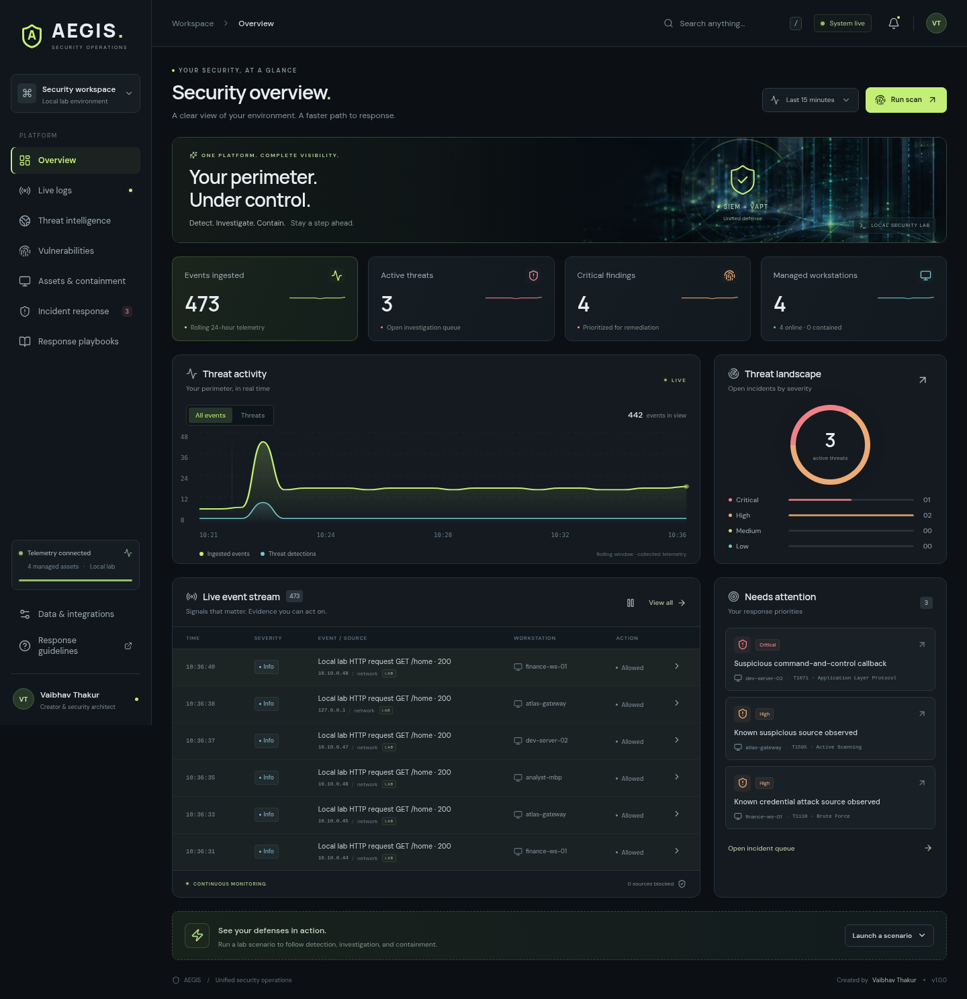

# AEGIS Security Platform

**Created by Vaibhav Thakur.** A combined SIEM, vulnerability assessment, and incident response dashboard with a live, animated cybersecurity interface.

AEGIS runs as a local security lab. You can observe live events, investigate detections and threat indicators, contain a lab workstation, discover real issues in the local lab service, apply a supported mitigation, and rescan to verify the result. Imported telemetry is distinguished from generated lab activity.



## Start the project

Requirements: **Node.js 24 or newer**, npm, and Python 3.10+ for the optional log collector. SQLite is provided by Node's built-in `node:sqlite`; no database server, Docker, or paid service is required.

Download the project from GitHub using **Code → Download ZIP**, extract it, and open a terminal in the extracted project folder. You can also clone the repository:

```bash
git clone https://github.com/Vaibhav222209/Cybersecurity.git
cd Cybersecurity
npm ci
npm run dev
```

If you downloaded the ZIP, skip the `git clone` and `cd` commands and run `npm ci` followed by `npm run dev` from the extracted folder. On Windows, use `npm.cmd` if PowerShell blocks the `npm.ps1` launcher. In this cloud environment, the existing checkout is `/workspace/Cybersecurity`.

Open **http://localhost:5173**. The API runs on **http://127.0.0.1:3001**; Vite proxies API requests to it. Use your cloud environment's port preview when working remotely. Keep using the existing checkout: cloud tasks already have an isolated workspace, so a separate Git worktree is unnecessary unless requested.

For a built dashboard served by the API:

```bash
npm run build
npm start
```

Open **http://localhost:3001**. After the lockfile exists, use `npm ci` for repeatable installation.

The API defaults to `HOST=127.0.0.1` and `PORT=3001`; its database defaults to `data/aegis.db` and can be relocated with `DB_PATH`. `DEMO_MODE=false` disables generated live traffic and the initial demonstration scan. The development Vite server listens on all interfaces for cloud previews, so restrict its exposure to trusted users. Keep environment values outside version control.

## What you can do

- **SIEM:** watch streaming events, filter the log feed, and correlate activity into incidents while retaining the underlying evidence.
- **Threat intelligence:** inspect indicators and their context; distinguish local demonstration data from imported observations.
- **Response:** block a source in the lab or isolate/quarantine a lab workstation, then verify that subsequent lab traffic is denied and still recorded.
- **Vulnerability assessment:** run the supported checks against the allowlisted local lab, inspect the evidence, apply a practical lab mitigation, and scan again.
- **Incident response:** follow guided playbooks with investigation, containment, eradication, recovery, and lessons learned steps.

The interface includes an animated security wallpaper, moving charts, severity cues, responsive navigation, and clear action feedback. Motion is reduced when your operating system requests reduced motion.

The default intelligence collection uses reserved documentation IP addresses, `.invalid` domains, and a harmless demonstration hash. These are explicitly labeled lab indicators. You can import authorized IP, domain, or hash indicators for subsequent event matching; no external commercial intelligence feed is claimed.

## Try the local security workflow

1. In **Overview**, select **Launch a scenario → Brute-force login**. Actual requests to the local lab generate events and correlated detections.
2. Open **Incident response**, review the affected asset and source, and block the suspicious source. Run the same scenario again and inspect the denied requests in **Live logs**. Evidence remains visible when traffic is blocked.
3. Launch **Malicious connection**, then use **Assets & containment** to isolate or quarantine `dev-server-02`. The lab's verification request returns HTTP 423. Restore it when you are ready to continue the assessment.
4. In **Vulnerabilities**, run a scan, inspect a finding's HTTP evidence, and apply its lab mitigation. Scan again to verify the result. Restore all contained assets before scanning the entire lab.
5. Open **Response playbooks**, follow the relevant guidance, and record completed steps. Playbook checkboxes record analyst progress; response and mitigation controls perform the actions separately.

The scanner and mitigations exercise these actual local HTTP behaviors:

| Check | Before mitigation | Verified mitigation |
| --- | --- | --- |
| Browser security headers | Missing CSP and framing protection | Restrictive Content-Security-Policy and `X-Frame-Options: DENY` |
| Public debug exposure | `/debug` returns service details with HTTP 200 | Disabled debug route returns HTTP 403 |
| Authentication rate limiting | Repeated invalid logins return HTTP 401 | Sixth attempt is throttled with HTTP 429 and `Retry-After` |

Findings use CWE weakness identifiers and illustrative severity scores for the lab. They do not claim an independently assigned CVE. Changes persist in the local database, and each supported mitigation performs an independent HTTP recheck before marking a finding mitigated.

## Forward your own live logs

The Python collector needs no additional packages. It reads one JSON object per line and forwards it to `/api/ingest`. These supported fields are strings: `timestamp`, `sourceIp`, `assetId`, `assetName`, `severity`, `category`, and `message`; optional `domain` and `hash` fields support intelligence matching. A nonempty `message` is required; the other fields are optional. The API accepts `critical`, `high`, `medium`, `low`, or `info` severity, valid IP addresses, messages up to 1,200 characters, and categories up to 80 characters. Use valid ISO 8601 timestamps within seven days of the current time, or omit the timestamp to use ingestion time. The API assigns the asset label from its registered inventory; a supplied `assetName` does not create an endpoint. If no `assetId` is supplied, the event is associated with the registered gateway.

For example, create an authorized local telemetry file outside the checkout:

```bash
mkdir -p /tmp/aegis-logs
printf '%s\n' '{"sourceIp":"192.0.2.25","severity":"medium","category":"authentication","message":"Failed login observed by the local agent"}' > /tmp/aegis-logs/events.jsonl
python3 scripts/collector.py \
  --file /tmp/aegis-logs/events.jsonl \
  --from-start --once
```

For continuous collection with restart recovery:

```bash
python3 scripts/collector.py \
  --file /tmp/aegis-logs/events.jsonl \
  --checkpoint /tmp/aegis-logs/collector.offset.json
```

Without `--from-start` or a saved checkpoint, the collector starts at the end of an existing file and sends only newly appended events. Append another JSON line to see it arrive live. `--from-start` imports existing lines; `--once` processes available events and exits. Press Ctrl+C to stop continuous collection.

Set `INGEST_TOKEN` securely in the API's environment and the collector's environment when using authenticated ingestion. The collector also supports `--url https://your-authorized-host/api/ingest`; TLS certificates are verified, and redirects are rejected to protect bearer tokens. Prefer the environment variable over `--token`, since command-line arguments can appear in shell history and process listings.

The collector skips malformed events with a diagnostic that does not reveal event contents. It follows rename rotation and detected file truncation, waits for complete lines, and retries temporary failures with bounded backoff. After exhausted retries, it exits with an error. With `--checkpoint`, restart with the same arguments to retry the unacknowledged event. Delivery is at least once: a lost response can cause a duplicate on retry. Without a checkpoint, replay requires `--from-start` and can also duplicate earlier events. Preserve the original logs as evidence.

## Validation

```bash
npm test
npm run build
```

The backend tests validate security behavior and lab operations. For an end-to-end log forwarding check, run the collector's `--from-start --once` example against the running API and inspect the live log feed.

## Scope and deployment

Containment and mitigations operate on the application's owned local lab. A source block denies matching lab requests; isolation/quarantine restricts the lab workload. They do **not** change your operating system's firewall, disable a physical workstation, or remediate arbitrary remote hosts. Imported telemetry helps investigation; it does not grant authorization to control its originating host. The scanner accepts only the designated local lab, with bounded checks rather than arbitrary network targets.

Use the project for learning, demonstration, and authorized local development. Before using it as an organizational SIEM, add authenticated users and role-based permissions, TLS, restricted network exposure, approved endpoint/firewall integrations, a trustworthy threat-feed integration, centralized collection, retention and backup policies, and an auditable incident-response process. A production command builds and serves the project; it is not a claim of enterprise readiness.

Playbooks reference [NIST SP 800-61 Rev. 3](https://csrc.nist.gov/pubs/sp/800/61/r3/final), [NIST Cybersecurity Framework 2.0](https://www.nist.gov/cyberframework), and [MITRE ATT&CK](https://attack.mitre.org/). They provide practical guidance, not a certification or a substitute for your organization's response approvals and legal scope.

See [architecture and operating boundaries](docs/architecture.md) for the event flow and response model.

See [validation results](docs/validation.md) for the integration and browser checks performed.
