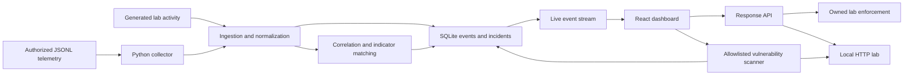

# Architecture and operating boundaries

AEGIS combines security monitoring and a deliberately vulnerable local service in one development project. React and Vite render the interface. Express provides the API, live event stream, lab workload, detection engine, scanner, and response actions. Node's built-in SQLite stores the platform state locally. The Python collector forwards authorized JSONL telemetry using standard HTTP requests.

## Evidence and detection

Events retain their source, timestamp, severity, category, asset context, and message. Generated lab events and imported telemetry have different provenance. Detectors correlate relevant activity and match configured indicators; a match provides a lead for investigation. It does not, by itself, establish that malware is confirmed. Analysts should examine evidence, indicator provenance, and benign explanations before escalating.

The live transport updates the dashboard as events and actions occur. SQLite persists state across API restarts. The local lab retains up to 5,000 recent events and 250 audit records; the dashboard receives up to 1,000 events and 100 audit records in each state snapshot. Preserve original source logs for longer retention. Response activity remains visible alongside its initiating evidence so an analyst can understand why an action was taken and whether it worked.

## Controls with a defined scope

Lab requests pass through enforcement gates that check source restrictions and workstation containment state. Blocking a source changes the outcome of subsequent matching lab traffic while preserving a denied-event record. Isolation/quarantine changes access to the owned lab workload. Releasing containment restores the permitted lab behavior. These controls do not alter a host firewall, kill operating-system processes, collect memory, or communicate with a real EDR agent.

The vulnerability scanner checks the application's fixed local lab target. A finding contains observed evidence and a supported mitigation. Applying a mitigation changes the relevant lab configuration or response. A rescan repeats the check to prove the resulting behavior. This is a practical assessment loop within an authorized lab; it is not a general-purpose remote exploitation framework.

An imported workstation name or address is context for investigation. It must not silently become an executable control target. Real endpoint control would require an authenticated agent or an approved EDR/firewall API, explicit asset inventory and permissions, rollback support, and verification of the endpoint's resulting state.

## Collection and reliability

The collector reads complete UTF-8 JSON lines, handles malformed input without logging sensitive event contents, and forwards supported event fields. It uses bounded HTTP retries, verified TLS when HTTPS is used, and rejects redirects. A durable checkpoint records the input file identity and the offset only after acknowledgement or a deliberately skipped invalid line. A restart can resume that offset; a rotated or truncated file starts from its beginning. Retrying after an acknowledgement is lost can duplicate an event, so the stream offers at-least-once rather than exactly-once delivery.

Keep original source logs, restrict their permissions, and use secure environment bindings for ingestion tokens. Never store credentials in source files, README examples, or checkpoints. Checkpoints contain file identity and offsets, not event bodies or tokens.

## Incident response references

Playbooks incorporate preparation and the detect, respond, and recover workflow described by [NIST SP 800-61 Rev. 3](https://csrc.nist.gov/pubs/sp/800/61/r3/final) in the context of [NIST CSF 2.0](https://www.nist.gov/cyberframework). They also reference [MITRE ATT&CK](https://attack.mitre.org/) technique context. Investigation, evidence preservation, authorized containment, verified eradication, controlled recovery, and lessons learned remain distinct tasks. These references guide the project; they do not certify it or eliminate the need for organizational policy.

Created by **Vaibhav Thakur**.
